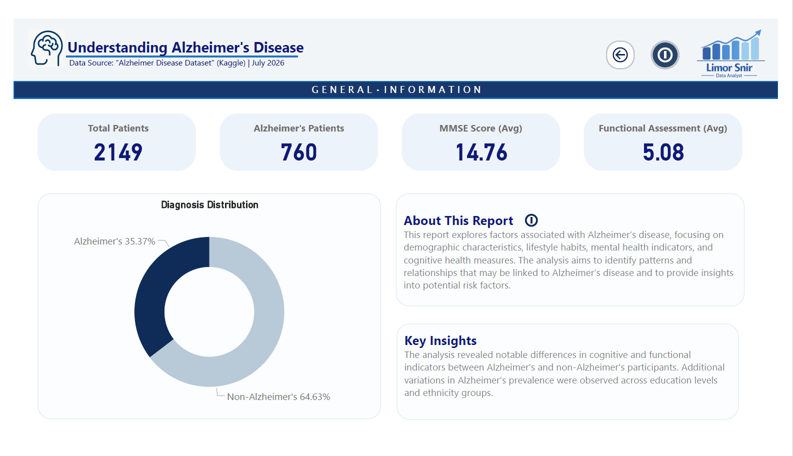
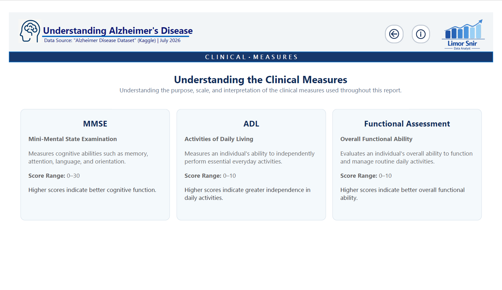

<h1 align="center"><b>Understanding Alzheimer's Disease</b></h1>

Power BI Dashboard

  <a href="Alzheimers_PowerBI_Dashboard.pbix"><b>Download the Power BI file (.pbix)</b></a>

---

<h2 align="center"><b>General Information</b></h2>

  

 

<h2 align="center"><b>Demographics</b></h2>

  

 

<h2 align="center"><b>Cognitive and Functional Analysis</b></h2>

  

 

<h2 align="center"><b>Clinical Measures</b></h2>

  

 

<h2 align="center"><b>Conclusions</b></h2>

  

